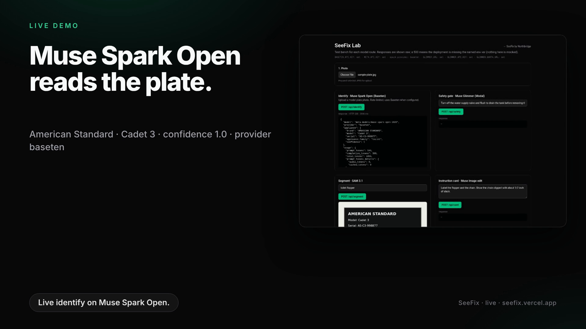

# SeeFix by Northbridge

> **It sees the part. It checks your work.**

SeeFix is a camera-first repair copilot. Point a phone at a broken fixture and SeeFix reads the model plate, finds the exact part you need to touch, shows the next step drawn on *your own photo*, stops you when a step is unsafe, and verifies the fix before you call it done.

Hero demo: **replacing a worn toilet flapper**. Avery (first-time renter) has a toilet that runs all night; Morgan (weekend fixer) wants proof the part matches and the job was done right.

**Live app:** https://seefix.vercel.app · **Model test bench:** https://seefix.vercel.app/lab


## Demo video

Narrated HyperFrames + Kokoro walkthrough of the live app (Muse Spark Open identify via Baseten, Glimmer safety gate, rate limits):

[](https://github.com/dl88jing/seefix/releases/latest/download/seefix-demo.mp4)

- **Video:** [seefix-demo.mp4](https://github.com/dl88jing/seefix/releases/latest/download/seefix-demo.mp4) (also in [`video/renders/seefix-demo.mp4`](video/renders/seefix-demo.mp4))
- **Poster:** [`video/renders/seefix-demo-poster.png`](video/renders/seefix-demo-poster.png)
- **Live app:** https://seefix.vercel.app · **Lab:** https://seefix.vercel.app/lab


Built by team **Northbridge** for the Meta AI Developer Hackathon (Indie track).

---

## Built during the hackathon

**All code in this repository was written during the Meta AI Developer Hackathon build window, starting Oct 26, 2026.** The commit history starts on Oct 26, 2026; nothing was ported from an earlier project.

Original work by Northbridge (everything under `src/` and `modal/`):

- The inference integration layer (`src/lib/*`): Muse Spark Open via Baseten (preferred) with Meta Model API fallback for Spark structured output, SAM 3.1 streaming segmentation, Muse Image edits, input validation and the "no mock data" 503 contract.
- API routes `/api/identify`, `/api/segment`, `/api/card`, `/api/safety`, `/api/health`.
- The `/lab` test bench (client-side SAM mask rendering on canvas) and the landing page.
- The Modal deployment of Muse Glimmer as a self-hosted safety gate (`modal/glimmer_gate.py`).

Open-source dependencies used (not our work):

| Dependency | Use | License |
|---|---|---|
| [Next.js](https://nextjs.org) 15, React 19 | App framework | MIT |
| [Tailwind CSS](https://tailwindcss.com) 4 | Styling | MIT |
| [openai](https://github.com/openai/openai-node) (Node SDK) | Client for OpenAI-compatible Muse Spark (Baseten) and Meta Model API | Apache-2.0 |
| [zod](https://zod.dev) | Runtime validation of model output | MIT |
| [@meta-sam/parser](https://www.npmjs.com/package/@meta-sam/parser) | Parses SAM 3.1 token output and decodes masks | SAM License |
| [vLLM](https://github.com/vllm-project/vllm) (`vllm/vllm-openai:muse-glimmer` image) | Serves Muse Glimmer | Apache-2.0 |
| [Modal](https://modal.com) Python SDK | GPU hosting for the Glimmer gate | Apache-2.0 |
| [Muse Glimmer 30B](https://huggingface.co/meta-models/Muse-Glimmer-30B) weights | Open-weights safety model | Apache-2.0 |
| ESLint, TypeScript, Geist font | Tooling / typography | MIT / Apache-2.0 / OFL |

Models used: `meta-models/muse-spark-open-1026` (Muse Spark Open via Baseten), plus Meta Model API `sam-3.1` / `muse-image-1.0` when that key is active (and, planned, realtime speech-to-text).

---

## Architecture

```
 Phone / laptop browser
 ┌──────────────────────────────────────────────────────────────────────┐
 │ getUserMedia camera ──► keyframe sampler (2 fps) ──► /api/segment     │
 │ mic ─────────────────► /api/asr (realtime speech-to-text)             │
 │ "done" ──► 8 s clip ──► Vercel Blob ──► /api/verify                   │
 └──────────────────────────────────────────────────────────────────────┘
                 │
                 ▼  Next.js 15 on Vercel (Node runtime)
 ┌───────────────────────────────────────────────────────────────────────────┐
 │ /api/identify  model plate ─► Muse Spark Open via Baseten (vision, JSON)   │
 │ /api/plan      appliance + symptom ─► Muse Spark Open repair plan          │
 │ /api/segment   frame + noun phrase ─► SAM 3.1 boxes + masks                │
 │ /api/verify    after-clip ─► SAM 3.1 + Muse Spark Open "is it fixed?"      │
 │ /api/safety    frame + planned step ─► Muse Glimmer (vLLM on Modal)        │
 │ /api/card      frame + instruction ─► Muse Image edit (annotated card)     │
 │ /api/recap     session ─► shareable repair recap                           │
 └───────────────────────────────────────────────────────────────────────────┘
                 │
                 ▼
 Data: Neon Postgres (Drizzle) · Vercel Blob (clips, cards) · Upstash (rate limit) · /evals
```

**Status (day one):** `/api/identify`, `/api/segment`, `/api/card`, `/api/safety` and `/api/health` are implemented and exercised from `/lab`. `/api/plan`, `/api/verify`, `/api/asr`, `/api/recap`, the live camera loop and the data layer are next.

### Routes

| Route | Input | Model | Output |
|---|---|---|---|
| `POST /api/identify` | `image` | Muse Spark Open (`meta-models/muse-spark-open-1026`) via Baseten Chat Completions + `response_format: json_schema` (strict); Meta `muse-spark-1.3` fallback | `{ appliance: { brand, model, serial, appliance_family, confidence }, provider }` (zod-validated) |
| `POST /api/segment` | `image`, `phrase` (short noun phrase, e.g. `toilet flapper`) | `sam-3.1` via Responses API, streaming, `mask_encoding=one_bit` | `{ objects: [{ id, box, confidence, mask }] }`; decode masks with `decodeMaskToRaster` |
| `POST /api/card` | `image`, `instruction` | `muse-image-1.0` via `/v1/images/edits` | `{ image: "data:image/png;base64,..." }` |
| `POST /api/safety` | `image`, `step` | Muse Glimmer 30B on Modal (OpenAI-compatible vLLM) | `{ hazard, severity, reason }` (zod-validated) |
| `GET /api/health` | none | none | which env vars are configured (booleans only) |

Images can be sent as `multipart/form-data` (field `image`) or JSON (`{"image": "data:image/jpeg;base64,..."}` plus text fields). Max 8 MB; `/lab` downsizes to 1600 px before upload.

**No mock data, ever.** If a route's env var is missing it returns HTTP 503 with `{"error":"not_configured","missing_env":"BASETEN_API_KEY"}` (or `META_API_KEY` / `GLIMMER_URL`). Upstream failures return the upstream status and message. API keys stay server-side only.

---

## Setup

```bash
git clone https://github.com/dl88jing/seefix && cd seefix
npm install
cp .env.example .env.local   # fill in values; .env.local is gitignored
npm run dev                  # http://localhost:3000 and /lab
```

### Environment variables

| Variable | Required for | Notes |
|---|---|---|
| `BASETEN_API_KEY` | `/api/identify` (preferred) | Baseten key for Meta Muse Spark Open. Prefer this when set. |
| `BASETEN_BASE_URL` | optional | Defaults to `https://inference.baseten.co/v1`. |
| `BASETEN_MODEL` | optional | Defaults to `meta-models/muse-spark-open-1026` (required model id on Baseten). |
| `META_API_KEY` | `/api/segment`, `/api/card`; Spark fallback | Meta Model API key from dev.meta.ai. `MODEL_API_KEY` is accepted as a fallback. Used for Spark only when `BASETEN_API_KEY` is unset. |
| `GLIMMER_URL` | `/api/safety` | Base URL of the Modal web endpoint (no trailing `/v1`). |
| `GLIMMER_API_KEY` | `/api/safety` (when the gate is locked); shared quota auth | Must match `GLIMMER_API_KEY` in the Modal secret `seefix-glimmer`. |
| `GLIMMER_QUOTA_URL` | `/api/safety`, `/api/identify` (on Vercel) | Web URL of the `quota` function (rate limiter) in the same Modal app. Without it those routes stay closed in production. |
| `META_BASE_URL` | optional | Defaults to `https://api.meta.ai/v1`. |
| `META_SPARK_MODEL`, `META_SAM_MODEL`, `META_IMAGE_MODEL`, `GLIMMER_MODEL` | optional | Override model ids when not on Baseten (defaults: `muse-spark-1.3`, `sam-3.1`, `muse-image-1.0`, `muse-glimmer`). |
| `SPARK_PER_IP_PER_HOUR`, `SPARK_GLOBAL_PER_DAY` | optional | Identify rate limits (defaults: 20 / hour / IP, 200 / UTC day). |
| `SAFETY_PER_IP_PER_HOUR`, `SAFETY_GLOBAL_PER_DAY` | optional | Safety gate rate limits (defaults: 10 / hour / IP, 100 / UTC day). |

### Muse Glimmer safety gate on Modal

Weights: [`meta-models/Muse-Glimmer-30B`](https://huggingface.co/meta-models/Muse-Glimmer-30B) (public, Apache-2.0, no HF token needed). bf16 serving needs about 72 GB of VRAM, so the gate runs on one H100 80GB and scales to zero when idle.

```bash
pip install modal && modal setup
modal secret create seefix-glimmer GLIMMER_API_KEY=<random-long-string>
modal run modal/glimmer_gate.py::download_weights   # CPU-only, fills the HF cache volume (~60 GB)
modal deploy modal/glimmer_gate.py                  # prints the web endpoint URL
```

Then set `GLIMMER_URL` (the printed `serve` URL), `GLIMMER_QUOTA_URL` (the printed `quota` URL) and `GLIMMER_API_KEY` on Vercel.

**Rate limits (before any paid call).** `/api/safety` and `/api/identify` are metered before Baseten, Meta, or the Glimmer GPU is touched. The `quota` Modal function (one CPU container, scale-to-zero, counters in the Modal Dict `seefix-glimmer-quota`, IPs HMAC-hashed) enforces separate buckets:

| Bucket | Route | Per IP / hour | Global / UTC day |
|---|---|---|---|
| `spark` | `/api/identify` | 20 | 200 |
| `safety` | `/api/safety` | 10 | 100 |

Each Vercel instance also pre-checks the per-IP window in memory. Over the limit returns HTTP 429 with `Retry-After`; on Vercel, if the limiter is unreachable the route fails closed (503). Override with `SPARK_*` / `SAFETY_*` at `modal deploy` time (and matching Vercel env if you mirror them).

**Muse Spark Open via Baseten.** `/api/identify` prefers `BASETEN_API_KEY` and calls `meta-models/muse-spark-open-1026` on `https://inference.baseten.co/v1` (OpenAI-compatible). Spark Open is a reasoning model (`reasoning_content` plus final `content`); the route uses generous `max_tokens` and treats empty `content` as a 502 rather than inventing a result. If Baseten is unset, it falls back to the Meta Model API Spark id.

**Meta API not yet active.** If the Meta account has no billing yet, Meta returns HTTP 402 `billing_error` / `billing_not_configured`. Meta-backed routes (and Spark when falling back to Meta) turn that into HTTP 503 `{"error":"meta_api_not_active"}` and `/lab` shows a "Meta API not yet active" notice instead of a raw error.

Day-one status: the gate is deployed on Modal (H100, scale-to-zero, max one container) and answers `/v1/models` and chat requests; a cold start with cached weights takes about 2.5 minutes. The `vllm/vllm-openai:muse-glimmer` build does not enforce `response_format` JSON schemas for Glimmer, so `/api/safety` asks for the JSON shape in the prompt, extracts the object and validates it with zod (a missing `hazard` is derived from `severity` and reported in a `normalized` field).

### Deploy the app

```bash
vercel env add BASETEN_API_KEY production
vercel env add BASETEN_BASE_URL production
vercel env add BASETEN_MODEL production
# Also keep GLIMMER_* and META_API_KEY (for SAM / Muse Image) on production.
vercel --prod
```

---

## License

MIT for the code in this repository (see `LICENSE`). Model weights and third-party packages keep their own licenses.
