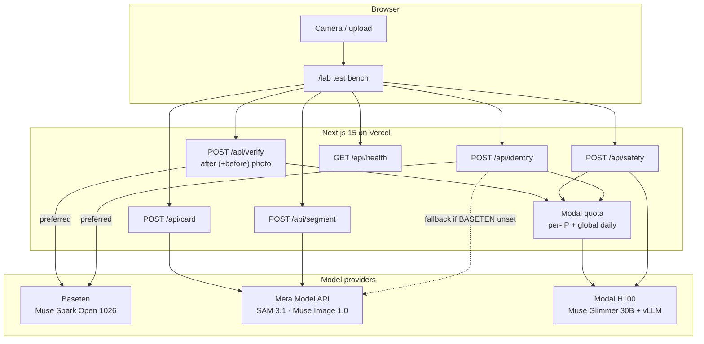

# SeeFix architecture

## Live vs planned

| Path | Status |
|---|---|
| identify · segment · card · safety · health | **Live** on https://seefix.vercel.app (measured Oct 31, 2026 PT) |
| verify (after photo + optional before → Muse Spark Open, strict JSON) | **Live** (measured Nov 1, 2026 PT) |
| plan · asr · recap · continuous camera / clip verify · Neon/Blob | Planned — listed in README ASCII diagram, not claimed as shipped |

## Failure contract

| Condition | HTTP | Body |
|---|---|---|
| Missing env var | 503 | `not_configured` + `missing_env` |
| Meta billing inactive | 503 | `meta_api_not_active` (Lab amber banner) |
| Rate limit | 429 | `rate_limited` + `Retry-After` |
| Quota service down on Vercel | 503 | fail closed |
| Upstream model error | 502 / upstream | `upstream_error` + source |

No mock appliance IDs, masks, cards, or safety verdicts are ever returned.
